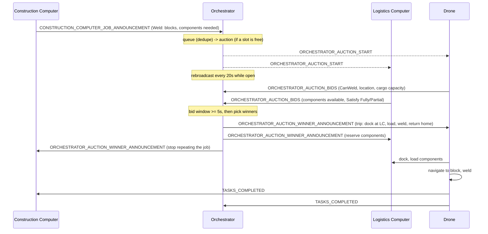
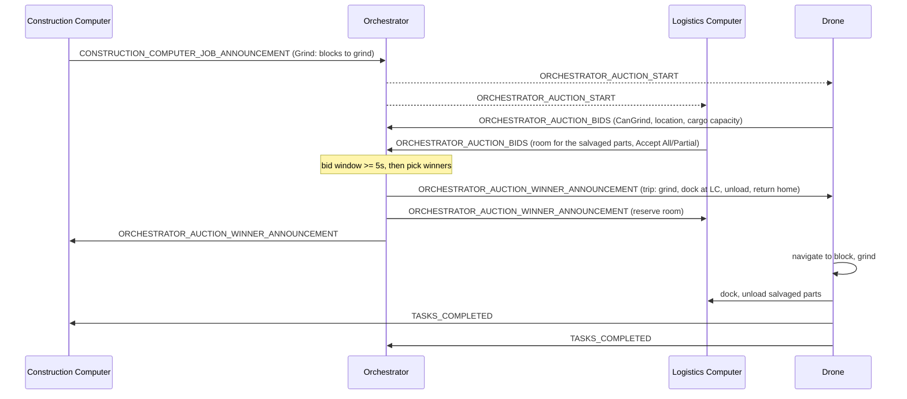
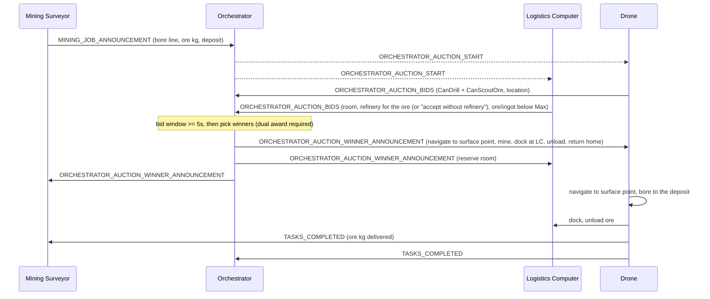

# Automata

Logistics and Construction drones for Space Engineers.

This mod introduces versatile AI blocks that allow you to automate distributed logistics.

## Use-case examples

- Faraway mining outpost, delivers ores to a different base via drone or truck.
- Factory bases ship components to other bases.
- Mining barge can handle a swarm of mining drones.
- Manage a swarms of construction drone to build projections.
- Deliver cargo to friendly bases.
- Deliver special payloads to enemy bases.

## Features

- Server first design: control research 

### Drone controller

The most basic component, the drone block will enable a grid with AI features, allowing the drone to complete simple construction tasks, like fetching and delivering goods.

The drone block is for both large grid and small grid, and will analyze the grid is mounted on to determine what its capable of. Note that the drone block itself needs other blocks to act.

One drone on its own is a powerful tool, and can handle a wide range of tasks, like:
- Building projected blocks, if it has a welder
- Grinding blocks, if tagged with the appropriate color, if it has a grinder
- Mining ores, if it has an ore detector and drill
- Scouting for ores, if it has an ore detector
- Delivering goods, given enough cargo
- Fetching goods, given enough cargo

These are just some examples, refer to the wiki for a full list of tasks.

Drones have 1 downside, and its that they cannot communicate with other drones, this is what the Orchestrator is for.

### Orchestrator

The Orchestrator serves as the brain for drone fleets, handling the scanning of tasks, and assigning tasks for inventories.

Consider the complex logistics of building a projection in location A, when the materials are distributed over several locations. The orchestrator will analyze inventories, search for available drones, and coordinate the drone swarm to efficiently complete the job.

Usually only 1 orchestrator is needed per player, as long as the grids are connected via radio or laser antennas.

### Logistics Computer

The logistics computer is an assistive block that analyzes inventories and reports them to the Orchestrator. Its what allows the logistics network to understand what inventories it has, and where.

## Job handshake workflows

Every job is a dual award (drone + at least one Logistics Computer) except the four designator job types,
which award a drone alone. Full written protocol: `TODO/10-handshake.md`. Failure states are listed as
text below each diagram, not drawn, to keep the happy path legible.

### Weld (Construction Computer)



Failure conditions (not diagrammed):
- No drone bid at all: `"no drone bid"`.
- No LC offers the components: `"no logistics computer offers the components"` — Weld is never awarded without one.
- No bid within `NoBidTimeoutSeconds` (60s default): `JOB_ANNOUNCEMENT_FAILED` sent to the CC, held `FailedJobHoldSeconds` (300s) before the CC's next announcement is taken.
- Bids present but no trip fits them within `AUCTION_LIFETIME_SECONDS` (120s): dropped, 60s hold.

### Grind (Construction Computer)



Failure conditions (not diagrammed):
- No drone bid: `"no drone bid"`.
- No LC offers room: Grind is never awarded without one (same rule as Weld, inverted direction).
- No bid within 60s: `JOB_ANNOUNCEMENT_FAILED`, 300s hold.
- Bids never add up within 120s: dropped, 60s hold.

### DeliverMissingInventory (Logistics Computer, requester short of quota)

```mermaid
sequenceDiagram
    participant RLC as Requester LC
    participant O as Orchestrator
    participant SLC as Supplier LC
    participant D as Drone

    RLC->>O: LOGISTIC_REQUEST (Deliver: dock location, items missing)
    O-->>D: ORCHESTRATOR_AUCTION_START
    O-->>SLC: ORCHESTRATOR_AUCTION_START
    D->>O: ORCHESTRATOR_AUCTION_BIDS (CanDock, cargo capacity, connector sizes; IsCargoDrone ranked first, IsOreHauler on ore-only jobs)
    SLC->>O: ORCHESTRATOR_AUCTION_BIDS (items available, Satisfy Fully/Partial)
    Note over O: rank suppliers by coverage, drones by score + cargo-drone bonus;<br/>chunk into round-robin trips, up to MAX_LOGISTICS_TRIPS (12)
    O->>D: ORCHESTRATOR_AUCTION_WINNER_ANNOUNCEMENT (per-drone trips: dock at supplier, load, dock at requester, unload)
    O->>SLC: ORCHESTRATOR_AUCTION_WINNER_ANNOUNCEMENT (reserve items)
    O->>RLC: ORCHESTRATOR_AUCTION_WINNER_ANNOUNCEMENT
    D->>SLC: dock, load items
    D->>RLC: dock, unload items
    D->>RLC: TASKS_COMPLETED
    D->>O: TASKS_COMPLETED
```

Failure conditions (not diagrammed):
- No supplier LC has any of the items: `"no logistics computer has the items"`.
- No drone bid: `"no drone bid"`.
- Bidding drones can't carry any of what's offered (connector mismatch, zero overlap): `"the drones can't carry any of it"`.
- What no bid covers is left uncovered: the requester LC re-announces the remainder on its own cadence.
- No bid within 60s / bids never add up within 120s: same `JOB_ANNOUNCEMENT_FAILED` pattern as above.

### CollectInventorySurplus (Logistics Computer, requester has surplus)

```mermaid
sequenceDiagram
    participant RLC as Requester LC
    participant O as Orchestrator
    participant TLC as Taker LC
    participant D as Drone

    RLC->>O: LOGISTIC_PUSH (Collect: dock location, surplus items)
    O-->>D: ORCHESTRATOR_AUCTION_START
    O-->>TLC: ORCHESTRATOR_AUCTION_START
    D->>O: ORCHESTRATOR_AUCTION_BIDS (CanDock, cargo capacity, connector sizes; IsCargoDrone ranked first, IsOreHauler on ore-only jobs)
    TLC->>O: ORCHESTRATOR_AUCTION_BIDS (room, Accept All/Partial)
    Note over O: rank takers by coverage, drones by score + cargo-drone bonus;<br/>chunk into round-robin trips, up to MAX_LOGISTICS_TRIPS (12)
    O->>D: ORCHESTRATOR_AUCTION_WINNER_ANNOUNCEMENT (per-drone trips: dock at requester, load, dock at taker, unload)
    O->>TLC: ORCHESTRATOR_AUCTION_WINNER_ANNOUNCEMENT (reserve room)
    O->>RLC: ORCHESTRATOR_AUCTION_WINNER_ANNOUNCEMENT
    D->>RLC: dock, load surplus
    D->>TLC: dock, unload surplus
    D->>RLC: TASKS_COMPLETED
    D->>O: TASKS_COMPLETED
```

Failure conditions (not diagrammed):
- No taker LC has room: `"no logistics computer has room for it"`.
- No drone bid: `"no drone bid"`.
- Bidding drones can't carry any of what needs collecting: `"the drones can't carry any of it"`.
- Leftover surplus: the requester LC re-announces the remainder.
- No bid within 60s / bids never add up within 120s: same failure pattern.

### MineOre (Mining Surveyor)



Failure conditions (not diagrammed):
- No LC bid: no award; the auction is dropped with a failure, and the surveyor holds the job (MineOre is never drone-only).
- No drone bid (no drill/ore-detector drone in range): `"no drone bid"`.
- Deposit found depleted by another scan before the drone arrives: the MS drops the job itself and returns the kg to the order (not an orchestrator-side failure).
- No bid within 60s / bids never add up within 120s: same failure pattern as the others.

### DesignatorScoutPoint (industrial designator, red)

Not announced over a channel: the player's designator submits the job directly into the Orchestrator's
own queue (`SubmitPlayerJob`, in-process call) with the Orchestrator itself as announcer. Only drones
with the `IsOreScout` profile may bid at all — this is a hard filter here, not just a ranking bonus — and
confirmation must happen within a few seconds or the order is dropped.

```mermaid
sequenceDiagram
    participant P as Player (designator)
    participant O as Orchestrator
    participant D as Drone

    P->>O: place point marker (industry pointer, red)
    Note over O: SubmitPlayerJob: GPS marker shown at once (pending, yellow); queued and auctioned immediately
    O-->>D: ORCHESTRATOR_AUCTION_START
    D->>O: ORCHESTRATOR_AUCTION_BIDS (CanScoutOre; non-scout bids refused outright)
    Note over O: best ore-scout bid wins, must happen within ConfirmTimeoutSeconds (10s default)
    O->>D: ORCHESTRATOR_AUCTION_WINNER_ANNOUNCEMENT (fly to point, ore scan, return home)
    Note over O: marker turns green (confirmed); ok sound; "Scout spot job accepted" via the broadcast controller (if on)
    D->>D: fly to point, ore scan
    D->>O: TASKS_COMPLETED
```

Failure conditions (not diagrammed):
- No ore-scout bid within `ConfirmTimeoutSeconds` (10s): the job (and marker, if it was the order's last job) is cancelled outright — no hold, no retry; the player must re-order. This bypasses the normal `JOB_ANNOUNCEMENT_FAILED` path entirely (there's no CC/LC/MS to notify).
- Out of range / no antenna reaching a scout drone: same as above, treated as "no bid."

### DesignatorScoutArea (industrial designator, blue)

Same single-award handshake as DesignatorScoutPoint, run once per sector. The designator (blue) defines the swept
area, the planner splits it into sectors, and each sector becomes its own job under one shared order/marker.

```mermaid
sequenceDiagram
    participant P as Player (designator)
    participant O as Orchestrator
    participant D as Drone

    P->>O: define swept area (industry pointer, blue)
    Note over O: ScoutPlanner splits the area into sectors; one order, one marker
    loop each sector
        Note over O: SubmitPlayerJob (same orderId): queued and auctioned immediately
        O-->>D: ORCHESTRATOR_AUCTION_START
        D->>O: ORCHESTRATOR_AUCTION_BIDS (CanScoutOre; non-scout bids refused outright)
        O->>D: ORCHESTRATOR_AUCTION_WINNER_ANNOUNCEMENT (waypoints, ore scan at each, return home)
        D->>D: fly sector waypoints, ore scan at each
        D->>O: TASKS_COMPLETED
    end
    Note over O: marker shown from the first sector's hit; stays until every sector job has ended
```

Failure conditions (not diagrammed):
- Same per-sector rule as DesignatorScoutPoint: no ore-scout bid within `ConfirmTimeoutSeconds` cancels that sector's job outright, no hold/retry.
- A sector job that aborts (drone lost, interrupted) is not auto-retried as part of the sweep; it ends like any other aborted job.

### DesignatorEngage (hostile designator, red)

Ordered like the scout jobs (in-process `SubmitPlayerJob`, the Orchestrator as announcer). Only drones with the
`IsCombatDrone` profile, managed by an orchestrator, with the three AI blocks (`HasDefenseSystems`) may bid. No GPS marker: the target moves.

```mermaid
sequenceDiagram
    participant P as Player (designator)
    participant O as Orchestrator
    participant D as Combat drone
    participant BC as Broadcast Controller

    P->>O: designate a hostile / neutral grid or character (red)
    Note over O: SubmitPlayerJob: queued and auctioned immediately
    O-->>D: ORCHESTRATOR_AUCTION_START
    D->>O: ORCHESTRATOR_AUCTION_BIDS (combat drone + AI blocks; other bids refused outright)
    Note over O: best combat-drone bid wins, within ConfirmTimeoutSeconds (10s default)
    O->>D: ORCHESTRATOR_AUCTION_WINNER_ANNOUNCEMENT (Engage target, return home)
    Note over O: confirmed: ok sound for the player
    O->>BC: "Combat engage accepted" (if Use broadcast controller)
    D->>BC: "Engaging target at GPS:...:x:y:z:" (drone's own broadcast controller, if on)
    D->>D: fly at the designator's hit, combat handover within the handover distance (max 2000 m)
    D->>D: target destroyed / disabled ("Target destroyed"), or AI has no target for the no-target time: take back
    D->>O: TASKS_COMPLETED
```

Failure conditions (not diagrammed):
- Friendly target, or nothing targetable hit: refused at once (error sound), no job.
- No combat-drone bid within `ConfirmTimeoutSeconds`: cancelled outright, no hold / retry (error sound).
- Flee, low power / hydrogen, an AI block lost or switched off: the drone takes back, goes home, reports Aborted with the reason.
- Target gone or disabled (no power, or disarmed): the fight ends, "Target destroyed", reported Completed.

### DesignatorEscort (hostile designator, blue)

Same ordering and confirmation as Engage. A hit within 5 m of the player escorts the player: the friendly
mobile grid that was hit (the base they stand on), else their character.

```mermaid
sequenceDiagram
    participant P as Player (designator)
    participant O as Orchestrator
    participant D as Combat drone
    participant BC as Broadcast Controller

    P->>O: designate a friendly mobile grid / character, or fire within 5 m of themselves (blue)
    Note over O: SubmitPlayerJob: queued and auctioned immediately
    O-->>D: ORCHESTRATOR_AUCTION_START
    D->>O: ORCHESTRATOR_AUCTION_BIDS (combat drone + AI blocks; other bids refused outright)
    O->>D: ORCHESTRATOR_AUCTION_WINNER_ANNOUNCEMENT (Escort target, return home)
    O->>BC: "Combat escort accepted" (if Use broadcast controller)
    loop until low power, recall or target gone
        D->>D: follow: route while far, station keeping at the follow distance (10-1000 m) above once close
        D->>D: AI Defensive detects an enemy: combat handover, then follow again
    end
    D->>O: TASKS_ABORTED (reason: low power / recalled / escorted target gone)
```

Failure conditions (not diagrammed):
- Hostile / static / NPC target: refused at once (error sound), no job.
- No combat-drone bid within `ConfirmTimeoutSeconds`: cancelled outright, no hold / retry.
- An escort always ends early by design (power, recall, target gone): reported Aborted with the reason, then the drone goes home / parks.

## Credits

- Industrial target designator charge sound: ["night vision"](https://freesound.org/s/636090/) by noahbangs, licensed under [CC BY 4.0](https://creativecommons.org/licenses/by/4.0/). Unmodified (file renamed). Also listed in `Automata/CREDITS.txt`, which ships with the mod.
